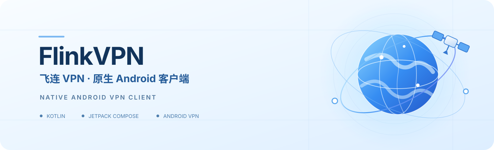

<!--
  FlinkVPN / 飞连 VPN
  Public repository landing page.
  Product and release claims are intentionally limited to the evidence linked below.
-->

  

  

    
    
    
    
    
    
  

  <h3>为 Android 打造的原生 VPN 客户端</h3>
  
清晰的连接体验 · 严谨的订阅处理 · 原生 VPN 生命周期

  

    <a href="#项目概览">项目概览</a> ·
    <a href="#功能模块">功能模块</a> ·
    <a href="#快速开始">快速开始</a> ·
    <a href="#架构一览">架构一览</a> ·
    <a href="#开发文档">开发文档</a> ·
    <a href="#安全与发布边界">安全与发布边界</a>
  

---

## 项目概览

**FlinkVPN（中文品牌：飞连VPN）** 是一个基于 Kotlin 与 Jetpack Compose 构建的 Android 原生客户端工程。仓库包含应用界面、账户与订阅流程、节点管理、配置导入、连接生命周期，以及 Android VPN / TUN / JNI 原生桥接等实现。

项目以客户端工程和可验证的技术边界为核心。账户、订阅、商品与订单等线上数据由独立服务端提供；本仓库不包含生产节点，也不代表服务端已部署或正式 APK 已发布。

| 项目 | 当前配置 |
| --- | --- |
| 产品名称 | FlinkVPN / 飞连VPN |
| Android applicationId | <code>com.gccwebos.android</code> |
| <code>versionName</code> / <code>versionCode</code> | <code>0.4.3</code> / <code>10</code> |
| 开发语言 | Kotlin |
| UI | Jetpack Compose + Material 3 |
| compileSdk / targetSdk / minSdk | 36 / 36 / 26 |
| Java | 17 |
| Gradle Wrapper | 9.4.1 |
| Android Gradle Plugin | 9.2.0 |

## 功能模块

| 模块 | 工程内容 |
| --- | --- |
| **原生应用界面** | 连接、节点、套餐、我的四个主要入口；统一主题、轻量材质、动效与状态呈现 |
| **账户与本地资料** | 原生账户会话、二次验证流程，以及与账户身份分离的本地订阅资料 |
| **订阅与节点** | 资源状态、订阅读取、配置校验与受限协议投影；节点选择、地区与延迟展示 |
| **配置导入** | 二维码扫描、手动导入与本地配置库；敏感材料采用独立的本地存储边界 |
| **VPN 运行时** | 连接协调器、服务生命周期、Android <code>VpnService</code>、TUN 与 JNI 原生桥接 |
| **钱包与订单** | 套餐目录、钱包、充值、订单历史与流水展示；以服务端返回的数据为准 |
| **应用更新** | 官方更新检查与安装交接流程 |

> **实现状态说明：** 仓库中存在相关 UI、客户端逻辑、测试和候选运行路径，不等于每项业务均已完成生产验收。尤其是实际订阅节点连通性、全部协议的 Android 互通、不同厂商设备兼容性和正式发布，必须分别以对应的最新验收证据为准。

## 架构一览

~~~mermaid
flowchart TB
    UI["Jetpack Compose UI 连接 · 节点 · 套餐 · 我的"]
    OWNER["ConnectionOwnerService Repository · StateFlow · Coordinator"]
    API["Portal API 账户 · 权益 · 商品 · 订单"]
    STORE["本地安全存储 Android Keystore"]
    VPN["ProductionVpnService Android VpnService · TUN"]
    JNI["JNI Bridge"]
    CORE["Mihomo Native Core Go"]
    
    UI --> OWNER
    OWNER <--> API
    OWNER <--> STORE
    OWNER --> VPN
    VPN --> JNI
    JNI --> CORE
~~~

### 代码目录

~~~text
app/
└── src/
    ├── main/java/com/gccwebos/android/
    │   ├── commerce/       # 套餐、钱包、订单与账单
    │   ├── core/           # 连接协调与资源生命周期
    │   ├── design/         # 主题、材质、动效与通用组件
    │   ├── manualimport/   # 二维码与手动配置导入
    │   ├── payment/        # 支付页面与安全跳转
    │   ├── portal/         # 账户、订阅与服务端数据
    │   ├── renewal/        # 续费提醒
    │   ├── update/         # 官方更新
    │   └── vpn/            # Android VPN 服务与原生接入
    ├── test/               # JVM 单元测试
    └── androidTest/        # Android 仪器与 UI 测试

native/
├── bridge/                 # Go / C / JNI 桥接
├── patches/                # 固定上游源码补丁
├── scripts/                # 原生依赖验证与构建脚本
├── notices/                # 原生组件许可证文本
└── source-lock.json        # 上游版本与摘要锁定

docs/                       # 架构、合同、验收与开发记录
scripts/                    # 源码、构建与发布策略检查
~~~

## 快速开始

### 环境要求

开始构建普通 Android Debug 包前，准备：

- JDK 17
- Android SDK Platform 36
- Android Build Tools 36.0.0
- 已安装并接受 Android SDK 对应许可
- 配置 <code>ANDROID_HOME</code> 或 <code>ANDROID_SDK_ROOT</code>

仅在构建原生 VPN 引擎时，还需要 NDK <code>29.0.14206865</code>。Gradle Wrapper 会使用仓库固定的 Gradle 9.4.1 分发包及 SHA-256 校验值。

### 1. 获取源码

~~~bash
git clone https://github.com/FlyLink-com/gccwebos-android.git
cd gccwebos-android
~~~

### 2. 构建 Debug 包并执行基础检查

**Windows PowerShell**

~~~powershell
.\build.ps1
~~~

**Linux / macOS**

~~~bash
chmod +x gradlew build.sh
./build.sh
~~~

构建脚本会执行：

- <code>:app:assembleDebug</code> — 编译 Debug APK
- <code>:app:testDebugUnitTest</code> — 执行 JVM 单元测试
- <code>:app:lintDebug</code> — 执行 Android Lint

### 3. 安装到 Android 设备

确认设备已开启 USB 调试并连接 ADB：

~~~bash
adb devices
adb install -r app/build/outputs/apk/debug/app-debug.apk
~~~

生成文件：

~~~text
app/build/outputs/apk/debug/app-debug.apk
~~~

Debug 包使用独立的应用 ID 后缀，不能把 Debug 签名视为正式版本的升级签名。

### 4. 其他验证命令

编译 Android instrumentation 测试 APK：

~~~bash
./gradlew --no-daemon --console=plain :app:assembleDebugAndroidTest
~~~

分别执行单元测试、Lint 与 Debug 构建：

~~~bash
./gradlew --no-daemon --console=plain \
  :app:assembleDebug \
  :app:testDebugUnitTest \
  :app:lintDebug \
  :app:assembleDebugAndroidTest
~~~

### 5. 原生 VPN 引擎

<code>native/</code> 下维护 Mihomo 上游源码锁定、补丁、Go / JNI 桥接及原生库构建脚本。原生库需要按仓库锁定的来源、摘要、ABI 和许可证要求生成或物化；生成的工具链、上游源码缓存和 <code>.so</code> 文件不应直接提交。

完整步骤、NDK 要求和验证边界见 [native/README.md](native/README.md) 与 [一键连接实现说明](docs/one-click-vpn-connection.md)。普通 Debug UI 构建与原生 VPN 引擎构建是两条不同路径。

## 验收与发布边界

为了避免把开发进度误写成产品承诺，请区分以下事项：

- **代码存在**：源码中有相应模块或运行路径。
- **自动化测试通过**：只对对应提交、测试范围和执行环境有效。
- **设备验收通过**：只覆盖实际执行的设备、Android 版本、协议与流量范围。
- **生产发布通过**：还需要真实服务端、实际订阅节点、完整设备矩阵、正式签名和发布流程验收。

仓库的 [一键连接验收记录](docs/one-click-vpn-connection.md) 包含 OPPO Android 13 / API 33 上的 synthetic Shadowsocks 连接与流量验证记录。该记录不证明真实订阅节点、其他协议的 Android 互通、所有 OEM / Android 版本或正式生产发布已经通过。

当前 Release 构建由 Gradle 生成未签名产物，正式签名在构建流程之外完成。请勿将 Debug APK、候选包或历史测试产物当作正式发布包。

## 开发文档

| 文档 | 内容 |
| --- | --- |
| [架构说明](docs/architecture.md) | 客户端模块、数据流与状态边界 |
| [后台接口合同](docs/backend-contracts.md) | Android 与 Portal 服务端之间的接口约束 |
| [连接协调器](docs/connection-coordinator.md) | 连接状态、取消、重连与资源清理 |
| [一键连接实现与验收](docs/one-click-vpn-connection.md) | 订阅读取、配置准备、VPN 生命周期与设备证据 |
| [协议投影合同](docs/offline-protocol-contract.md) | 支持的协议形状、字段约束与拒绝边界 |
| [自动订阅导入](docs/automatic-subscription-import.md) | 本地订阅资料与自动导入流程 |
| [手动配置导入](docs/manual-import-platform.md) | 二维码、文件与手动导入能力 |
| [Android 开发工具链](docs/android-development-toolchain.md) | JDK、SDK、Gradle、NDK 与构建环境 |
| [原生引擎说明](native/README.md) | Mihomo、Go、JNI、ABI 与许可证 |
| [发布准备](docs/stable-release-preparation.md) | 正式签名与发布前检查 |
| [开发任务](TASKS.md) | 仓库内维护的任务清单 |
| [更新日志](CHANGELOG.md) | 历史版本变更 |

## 安全与发布边界

- 不要提交账户密码、访问令牌、订阅 URL、节点凭据、真实配置、签名密钥或其他生产秘密。
- 不要在公开 Issue、截图或日志中粘贴账户、支付、订阅和设备敏感信息。
- 账户会话与本地订阅资料具有不同的身份和存储边界；相关实现与限制见 [账户与本地订阅说明](docs/mobile-login-account-parity.md)。
- 原生依赖通过固定来源、版本、摘要和许可证材料进行管理；不要绕过校验替换原生二进制。
- 报告问题时请附 Android 版本、设备类型、复现步骤和脱敏日志；不要附带真实账号或订阅凭据。

## 参与贡献

欢迎通过 [GitHub Issues](https://github.com/FlyLink-com/gccwebos-android/issues) 提交问题或改进建议，也欢迎提交 Pull Request。

提交前请：

1. 说明问题背景、预期行为与实际行为。
2. 为行为变化补充或更新测试。
3. 运行与改动范围对应的构建、测试和 Lint。
4. 在 PR 中注明验证的提交、设备与测试范围。
5. 确认没有提交密钥、令牌、真实订阅配置或用户数据。

## 许可证

**当前仓库尚未声明项目级许可证。** GitHub 仓库公开可见，不代表自动授予复制、修改、再发布或商业使用的权利。在仓库根目录补充并确认项目许可证之前，请不要假设整个 Android 项目可以按某种开源许可证自由复用。

Mihomo、CMFA 及其他第三方组件的许可证和声明位于 [native/LICENSE](native/LICENSE)、[native/notices](native/notices/) 及各依赖源文件中；这些组件自身的许可证不自动替代整个仓库的项目级许可证。

---

  FlinkVPN · 飞连VPN — Android client engineering repository
   
  Repository slug: <code>gccwebos-android</code> · Product name: <code>FlinkVPN</code> / <code>飞连VPN</code>

